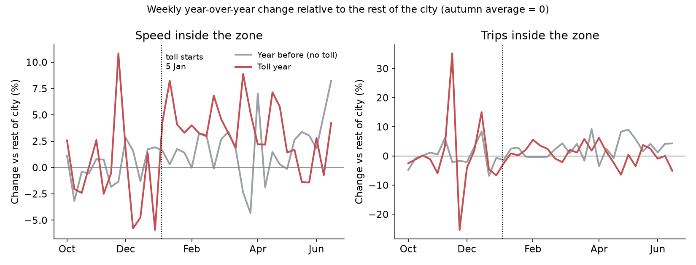
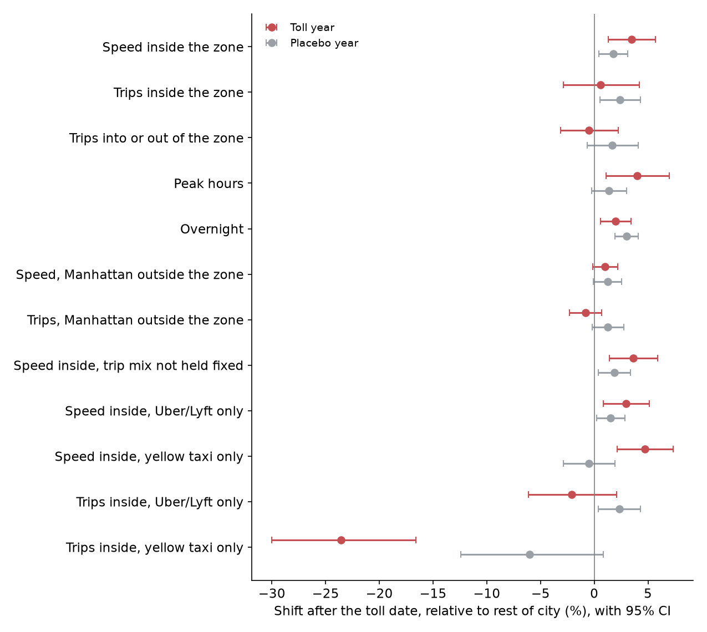

# Did NYC's congestion toll speed up trips in Manhattan's core?

A dbt project and a short analysis on public NYC taxi and Uber/Lyft trip records. It asks whether trips inside the new toll zone got faster, or fewer, after the toll started on 5 January 2025, compared with the rest of the city. The README is written like a take-home answer, and the analysis plan was committed before any result was computed ([`ANALYSIS_PLAN.md`](ANALYSIS_PLAN.md), first commit).

**Short answer: trips inside the zone got about 3.5% faster relative to the rest of the city after the toll, roughly a third of a mile per hour. But the same size of shift showed up the year before, when there was no toll (1.8%), and my pre-set rule says a placebo above half the main estimate means this design cannot separate the toll from ordinary year-to-year drift. So I would not claim the toll made these trips faster. I also found no change in the number of trips inside the zone, to within about plus or minus 3.5%.**



## The question

Since 5 January 2025, vehicles entering Manhattan south of 60th St pay a toll. Two questions, in this order:

1. **Primary:** did the average speed of for-hire trips inside the zone change after the toll, relative to trips elsewhere in the city?
2. **Secondary:** did the number of trips inside the zone, or into and out of it, change?

What this data can and cannot say. Taxis and Uber/Lyft do not pay the $9 car toll. Their passengers pay a per-trip charge ($0.75 for a taxi, $1.50 for Uber/Lyft). So trip speed is a read on traffic as for-hire vehicles experience it, and trip volume mixes a small price rise with any change in traffic. Neither one counts private cars.

## Data

NYC Taxi and Limousine Commission (TLC) trip records: yellow taxis and high-volume for-hire vehicles (Uber/Lyft). October to June for four seasons: 2022-23, 2023-24, 2024-25 (the toll starts mid-season) and 2025-26. About 858 million trips across 72 monthly files, pulled on 2026-11-12 (see [`data_manifest.csv`](data_manifest.csv)). TLC revises these files from time to time, so a later pull can differ slightly.

Source: [TLC trip record data](https://www.nyc.gov/site/tlc/about/tlc-trip-record-data.page). Toll background: [MTA congestion relief zone](https://congestionreliefzone.mta.info/).

The raw files are not committed. `scripts/extract.py` reads them straight from TLC's public storage and keeps one small weekly summary per month (trips, miles and minutes by service, week, peak or not, and pickup and drop-off zone). It waits and retries when TLC's servers refuse requests.

## Method

**Which zones are inside the toll zone.** I did not type a list. From the data, a taxi zone is "inside" when most trips that start and end in that same zone were charged the congestion fee after the toll began. That gives 38 zones inside and 6 neighbouring zones (kept out of the comparison). It is in [`seeds/cbd_zones.csv`](seeds/cbd_zones.csv), and a dbt test checks the count.

**Groups.** Inside: both ends of the trip are in the zone. Comparison: neither end is in Manhattan (rest of the city). Also reported: trips with one end inside, and trips within Manhattan outside the zone.

**Estimate.** Each week I take the year-over-year change in the inside group minus the same change in the comparison group. Weeks are lined up across seasons 364 days apart so Mondays meet Mondays. The estimate is the average of that gap after 5 January minus the average before it, in log terms, shown as a percent. The week of the toll start is left out. Confidence intervals use Newey-West errors (4 weekly lags), since neighbouring weeks are not independent. This is a difference-in-differences design, not a randomised test.

**Speed.** A raw average speed can move just because the mix of trips moved (more airport runs, say). So speed is mix-adjusted: every season is weighted using the 2023 mix of service, pickup and drop-off zone pair, and peak or not. Cells with fewer than 200 baseline trips are dropped.

**Placebo.** The same calculation one year earlier (2023-24 against 2022-23), where nothing happened. It is the yardstick for "how big a shift shows up by chance or drift". The rule I set before looking: if the placebo shift is more than half the toll-year shift, the design cannot separate them, and I say so.

## Results

| Mix-adjusted speed inside the zone | Toll year (2024-25 vs 2023-24) | 95% CI | Placebo year (2023-24 vs 2022-23) | 95% CI |
|---|---|---|---|---|
| All hours (primary) | +3.5% | +1.3% to +5.7% | +1.8% | +0.4% to +3.1% |

Average speed inside the zone, January to June weeks: 8.43 mph (2023-24), 8.66 mph (2024-25). The rest of the city went from 13.89 to 13.78 mph over the same two seasons.

The placebo is 51% the size of the toll-year estimate, just over the 50% line, so by the plan the primary result is "cannot separate". The smallest shift this design could reliably detect is 3.0%, and the estimate is 3.5%, so we are working at the edge of what the data can resolve.



**Checks** (full tables in [`experiment/results.md`](experiment/results.md)):

- **Peak against overnight.** Cars pay $9 in peak hours and $2.25 overnight, so a traffic effect should be larger at peak. Peak speed rose 4.0% (placebo 1.4%); overnight, where the toll is a quarter of the peak rate, rose 2.0% (placebo 3.0%). Peak up more than overnight is what a real toll effect would look like, but the intervals overlap, so it is a hint, not a result.
- **Number of trips.** Inside the zone +0.6% (CI -2.9% to +4.2%; placebo +2.4%). Into or out of the zone -0.5% (CI -3.2% to +2.2%). Nothing detectable, and the intervals are wide enough that a change of a few percent would not show.
- **Spillover.** Manhattan outside the zone: speed +1.0%, trips -0.8%, both within noise of zero and of the placebo.
- **Sensitivity.** Without mix adjustment +3.6%; Uber/Lyft only +3.0% (placebo +1.5%); yellow taxi only +4.7% (placebo -0.5%). Same direction every time, same size of placebo problem for the main cuts.
- **Yellow taxi trips inside the zone** fell 23.6% relative to the rest of the city (placebo -6.0%). That is a much steeper fall than the year before, but Uber/Lyft trips inside the zone moved only -2.1%. I would not read this as a toll effect without more evidence: taxi trips were already falling the year before (-6.0%), and a $0.75 per-trip charge is small against a typical fare.
- **Second toll season (2025-26), description only.** Speed inside the zone -0.9% and trips inside the zone -14.1% against the rest of the city. The comparison group itself kept growing quickly (100M trips against 91M a year earlier), which pulls any "relative to the rest of the city" number down. I report it for completeness and draw no conclusion.

## Caveats

- **One treated area and one start date.** With a single treated unit, the placebo year is the only direct read on how much this measure moves with no toll. One placebo year is a thin yardstick, which is part of why the conclusion is "cannot separate" and not "no effect".
- **For-hire trips, not private cars.** See above. A speed change in taxis and Uber/Lyft is not the same as a change in car traffic.
- **The comparison group is not perfect.** The rest of the city grew in Uber/Lyft trips much faster than Manhattan's core over these years, and trips elsewhere may be affected by the toll too (for example, people shifting where they ride). If so, the gap moves for reasons unrelated to speed inside the zone.
- **Weekly summaries, not individual trips.** I aggregate to weeks and zone pairs in the extract, so I cannot look at time of day more finely than peak and overnight.
- **Other things changed too.** Bus lanes, construction, weather, a fare change or driver supply shifts could move speeds in the same weeks. None is modelled here.
- **Data revisions.** TLC corrects its files after release.
- **BigQuery not run.** The BigQuery target is configured and parses, but I have not run it against a real project. Everything here ran on DuckDB.

## Recommendation

Do not report a speed-up from the toll based on this data alone. The size and direction of the change are consistent with a small effect (peak-hour speed up a few percent, nothing seen in trip counts), and the 2023-24 placebo shows a shift of nearly the same size with no toll. To settle it I would:

1. Add a better yardstick: private-car speeds from city traffic sensors or a mapping provider, and several earlier placebo years.
2. Use individual trips with timestamps, so peak and off-peak can be compared by hour inside the same week.
3. Fit a model with several comparison groups (a synthetic control), instead of one "rest of the city" series.

## Attacks I tested, and what is left

Tested:

- **A bad zone list.** Zones come from the fee column in the data, and tests check that nearly all inside-zone trips are charged after the toll starts and that comparison-group trips are not.
- **Trips lost on the way.** A test checks that total trips in the final table equal total trips in the files.
- **Different weeks across years.** A test checks that every season has the same 37 weeks.
- **Chance and drift.** The placebo year, a pre-set decision rule, and autocorrelation-robust intervals.
- **Changing mix.** Mix-adjusted speed, plus the version without adjustment.
- **A single service driving it.** Taxi-only and Uber/Lyft-only cuts.
- **Wrong timing.** Peak against overnight, and spillover to Manhattan outside the zone.

Not covered: private-car traffic, causes other than the toll, a fully independent comparison group, BigQuery execution, and TLC revisions after 2026-11-12.

## How it is built

```
seeds/                 taxi_zones.csv (TLC lookup), cbd_zones.csv (zones inside the toll zone)
models/staging/        types and names only
models/intermediate/   int_od_weekly (assigns each zone pair a segment), int_cell_baseline_weights
models/marts/          fct_weekly_segment (one row per season, week, segment, service, peak flag)
                       agg_season_segment (season-level summary for a quick look)
tests/                 8 custom data tests (grain, no trips lost, same weeks each season,
                       fee charged inside the zone, comparison group not charged, 38 zones)
experiment/analyze.py  reads the fact table, writes results.md and charts/
fixtures/              a small sample so CI can run the whole pipeline
```

`dbt build` runs 45 nodes: 2 seeds, 6 models, 37 tests. The SQL uses dbt's cross-database macros so the same models target DuckDB and BigQuery. CI (`.github/workflows/ci.yml`) builds the project on the sample and runs the analysis script in check mode.

## Run it

```bash
python -m venv .venv && source .venv/bin/activate
pip install -r requirements.txt
python scripts/extract.py        # about 70 files; slow because TLC rate-limits
export DBT_PROFILES_DIR=.
dbt build
python experiment/analyze.py
```

To run without downloading anything, use the sample (numbers will differ from the full data):

```bash
dbt build --vars '{landing_glob: fixtures/weekly_od_sample.parquet, min_baseline_trips: 50}'
python experiment/analyze.py --check
```

BigQuery (sandbox works) needs the weekly parquet files loaded into a table `tlc_raw.weekly_od` first (dataset name set by `BQ_RAW_DATASET`), then:

```bash
gcloud auth application-default login
export GCP_PROJECT=your-project-id
dbt build --target bq
```

Status: DuckDB verified end to end. BigQuery not run.

MIT licence.
